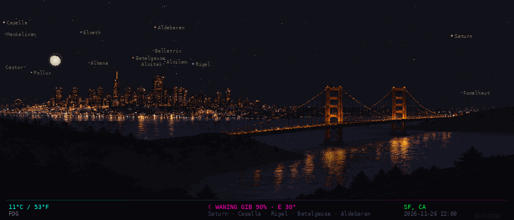

  

  <em>Tonight's sky over SF, CA — updated daily by <a href=".github/workflows/skyforge.yml">Skyforge</a></em>

---

### Hey, I'm Hursh Naik

A pixel-art night sky generated fresh every night showing the real stars, planets and Moon over SF at 10 PM, plus live weather.

**How it works:** The scene is the view from Battery Spencer in the Marin Headlands, looking south-east over the Golden Gate Bridge to the city. Every night a Python script places each star to magnitude 5 (Hipparcos-based catalogue), the planets and the Moon at their true compass bearing and altitude for 10 PM Pacific using PyEphem, dims them by atmospheric extinction near the horizon, hides whatever is behind the skyline, draws the Moon with its exact phase and tilt, fetches live weather from Open-Meteo, and renders it all as an animated pixel-art GIF. Runs on a daily GitHub Actions cron.

---

### Projects

| Project | Description |
|---------|-------------|
| [CircuitHistology](https://github.com/hn6767/CircuitHistology) | Mechanistic interpretability research — dissects how LLMs perform factual reasoning using prompt ablation and attribution graph analysis on Gemma-2-2B |
| [GodelEncoder](https://github.com/hn6767/GodelEncoder) | Neural theorem prover that encodes Metamath/Lean proofs into structured matrices, using spectral analysis and GPT-f style fine-tuning for proof generation |
